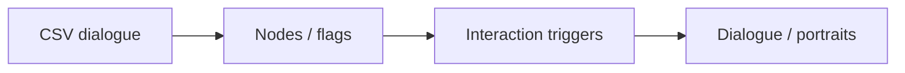

# Cylinder — Dialogue & Interaction Systems

[English](README.md) · [Korean](README.ko.md) · [Japanese](README.ja.md)

**C# · Unity · CSV** · チーム開発での担当

[開発事例を見る](https://ysl-ryudo.github.io/ja/work/cylinder/) · [Portfolio](https://ysl-ryudo.github.io/ja/)

チーム制作のUnityアドベンチャープロジェクトです。ゲーム全体の単独制作ではなく、担当した会話・インタラクションシステムを紹介します。

## 取り組んだ課題

進行状況、感情状態、インタラクション条件に応じて会話を変え、肖像とUIを更新する必要があります。

## 担当した実装と設計

CSV読み込み、会話ノード・UI、肖像、フラグ、トリガーを改修し、チュートリアル・カットシーン進行を連携しました。共同変更を含むYSLブランチでは会話・感情状態のコミットで担当を示します。

### 実装概要 · 概念フロー

## 担当した内容

- CSV読み込み、会話ノード・UI、立ち絵、フラグ、操作トリガーを結ぶ会話システムを改修しました。
- 会話・感情状態の変化、チュートリアル進行、カットシーン連携を担当しました。
- インベントリ、ポータル、操作UIを担当しました。YSLブランチにも他のメンバーのコミットが含まれ、名前だけで担当者を判断しません。

## 貢献の根拠

- [Dialogue rework / 대화 개편 / 会話改修](https://github.com/YSL-RyuDo/Cylinder-1/commit/89a3080fa996dd7b30180d51d87a1db21f7e3ec5)
- [Emotion state / 감정 상태 / 感情状態](https://github.com/YSL-RyuDo/Cylinder-1/commit/719fe90233e191f8d4df5fe5b05bb0143525edcb)
- [Working branch / 작업 브랜치 / 作業ブランチ](https://github.com/YSL-RyuDo/Cylinder-1/tree/YSL)

コミットは記載した変更の根拠であり、貢献率の点数ではありません。外部素材・チームメンバーの貢献は区別します。

## 実行・コードの確認

[ProjectVersion.txt](ProjectSettings/ProjectVersion.txt)記載のUnity版で開いてください。パッケージロックとシリアライズ済み素材を維持し、Unityを開く前に対象ブランチを選んでください。

YSLブランチのシーンとBuild Settingsを確認してください。未確認の起動シーンは指定していません。

## 開発・検証範囲

YSLブランチにはmain未反映の作業とチーム共有の変更があります。引用コミットで担当範囲を区別し、Assets/Scripts/YSL内の全機能を単独制作したとは主張しません。デモ可能な状態は対象ブランチで確認してください。

## 詳細資料

- [既存の詳細開発・利用・検証資料（韓国語）](docs/DEVELOPMENT_REFERENCE.ko.md)

## 実装の確認方法

会話改修と感情状態変更のコミットを併せて読めます。実装はYSLブランチで確認でき、ブランチ名は単独制作を意味しません。
