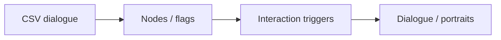

# Cylinder — Dialogue & Interaction Systems

[English](README.md) · [Korean](README.ko.md) · [Japanese](README.ja.md)

**C# · Unity · CSV** · Team contribution

[Explore the case](https://ysl-ryudo.github.io/en/work/cylinder/) · [Portfolio](https://ysl-ryudo.github.io/en/)

A team Unity adventure project. This portfolio entry focuses on my dialogue and interaction systems, not ownership of the entire game.

## The engineering problem

Dialogue needs to respond to progression, emotion state and interaction triggers, while presenting the right portraits and UI.

## My implementation

I reworked CSV loading, dialogue nodes/UI, portraits, flags and triggers, and integrated tutorial/cutscene progression. Specific dialogue and emotion-state commits identify my work within the shared YSL branch.

### Implementation overview · conceptual flow

## My contribution

- Reworked dialogue around CSV loading, dialogue nodes/UI, portraits, flags and interaction triggers.
- Added dialogue/emotion-state changes and worked on tutorial progression and cutscene integration.
- Worked on inventory, portals and interaction UI. The YSL branch also includes teammates' commits; a folder or branch name alone is not authorship evidence.

## Contribution evidence

- [Dialogue rework / 대화 개편 / 会話改修](https://github.com/YSL-RyuDo/Cylinder-1/commit/89a3080fa996dd7b30180d51d87a1db21f7e3ec5)
- [Emotion state / 감정 상태 / 感情状態](https://github.com/YSL-RyuDo/Cylinder-1/commit/719fe90233e191f8d4df5fe5b05bb0143525edcb)
- [Working branch / 작업 브랜치 / 作業ブランチ](https://github.com/YSL-RyuDo/Cylinder-1/tree/YSL)

Commits are evidence of the stated changes, not a percentage-of-authorship score. Third-party assets and teammates' work remain separately credited.

## Open and inspect

Open the project with the Unity version recorded in [ProjectVersion.txt](ProjectSettings/ProjectVersion.txt). Keep its package lock and serialized assets intact. Select the documented branch before opening Unity.

Inspect the YSL branch's scenes and Build Settings; this overview does not prescribe an unverified startup scene.

## Development and verification scope

The YSL branch contains substantial work absent from main and includes shared team changes. The cited commits identify my contribution; no claim is made that every system under Assets/Scripts/YSL was solely authored by me. Demonstration readiness must be assessed on the selected branch.

## Further documentation

- [Existing detailed development reference (Korean)](docs/DEVELOPMENT_REFERENCE.ko.md)

## How to evaluate the work

Read the dialogue-rework and emotion-state commits together. Use the YSL branch to inspect the implementation; its name is not a sole-authorship claim.
